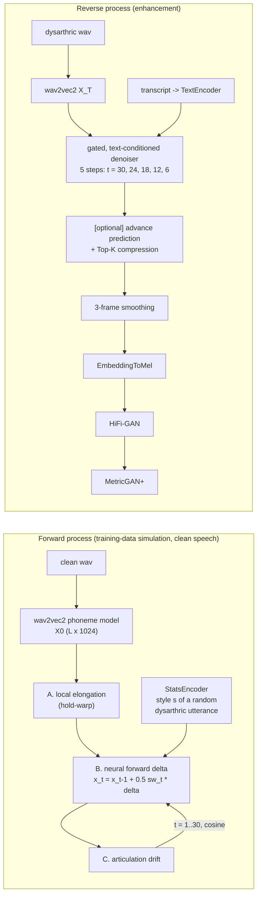
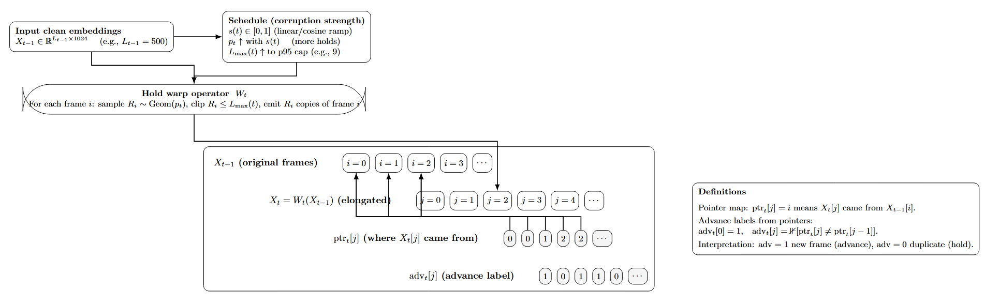
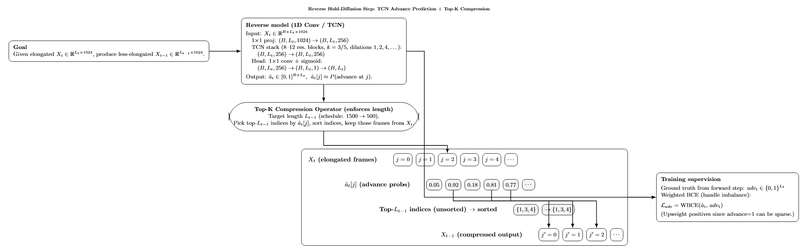

# Structured Forward–Reverse Diffusion for Dysarthric Speech

Conditional diffusion in self-supervised speech-embedding space for modeling and restoring moderate dysarthric speech. The work uses **no parallel clean/dysarthric recordings**.

Clean speech is mapped to 1024-d wav2vec2 phoneme-model frames. A structured **forward process** learns to corrupt those frames the way moderate dysarthria does: temporal elongation, articulatory slurring, phonation instability, and pause/rhythm irregularity. A **text-conditioned reverse denoiser** is trained on the simulated chains and then applied to real dysarthric speech. The output is decoded to audio through an embedding-to-mel network and a pretrained HiFi-GAN vocoder.

📄 Report: [`docs/report.pdf`](docs/report.pdf), by Sanjay Balasubramaniam and Jay Park (USC).

> **Code provenance.** The exploratory stage was ported from the original notebooks: the statistics, the hold-warp operator, the hand-designed forward modules, and the per-factor reverse models. A test checks that the port matches the original functions to float precision. The original code for the final combined pipeline (report Section 3.5) was lost. It is **re-implemented here from the report**, and its modules load the surviving trained checkpoints. The results quoted below come from the original code and have not yet been reproduced with this re-implementation. See [Code status](#code-status).

---

## Pipeline



### Forward process

| Stage | What it does | Code |
|---|---|---|
| Statistics | A joint 100-cluster k-means over clean and moderate frames. Runs of identical labels measure how long speakers hold phone-like units. | `dysdiff/stats.py`, `scripts/compute_stats.py` |
| Hold-warp elongation | Holds each frame for R ~ Geom(p_t) frames, capped at the p95 run length. Records a pointer map and exact **advance/hold labels**. | `dysdiff/forward/hold_warp.py` |
| Articulation | Corrupts spans at phoneme transitions: smooth drift, boundary blur, neighbour-frame confusion, partial replacement. | `dysdiff/forward/articulation.py` |
| Phonation | Targets stable voiced spans with gain flutter, smooth jitter, breathy weakening, and coherence loss. | `dysdiff/forward/phonation.py` |
| Pause / rhythm | Flattens and weakens pause-like spans, re-indexes rhythm spans irregularly, and adds global timing jitter. | `dysdiff/forward/pause_rhythm.py` |
| StatsEncoder | Dilated CNN with mean+std pooling producing a 128-d speaker style vector. Trained with an unpaired proxy objective. | `dysdiff/models/stats_encoder.py` |
| Neural forward diffusion | 6-block dilated TCN (1024→384) with sinusoidal time and style conditioning. Learns to reproduce the hand-designed chain's per-step delta. | `dysdiff/models/diffusion.py` |

All corruption operates on embeddings, so length and alignment stay monotonic and every step has an exact training target.

<p align="center">
  <br/>
  <em>Hold-warp: geometric holds, pointer map, and advance labels.</em>
</p>

### Reverse process

* **Gated reverse denoiser.** It uses the same TCN backbone, conditioned on the timestep and on a character-CNN transcript embedding. It predicts a correction δ that is multiplied by a learned per-sample **scale gate** in [0, 1]. At inference each step is also norm-clipped to 20% of the frame norm. Training loss: `1.0·L(δ) + 0.5·L(x̂_{t-1}) + 0.3·smoothness`, with a cosine learning-rate schedule.
* **Few-step sampling.** Sampling uses 5 evenly spaced steps instead of 30. Per-step errors compound across the chain, and with 30 steps the accumulated error showed up as noise after vocoding.
* **Elongation reversal.** A TCN predicts the advance probability of each frame. Top-K selection (or thresholding) then compresses the sequence while keeping it monotonic. It is trained with weighted BCE on the hold-warp labels.
* **Synthesis.** EmbeddingToMel (1024→512, 3 conv layers, →80 mels) is trained on clean speech. It feeds the pretrained SpeechBrain HiFi-GAN (16 kHz), followed by MetricGAN+ to suppress vocoder artifacts on off-distribution embeddings.

<p align="center">
  <br/>
  <em>Reverse hold-diffusion step: advance prediction and Top-K compression.</em>
</p>

---

## Results

### Measured dysarthric elongation (TORGO, wav2vec2 embeddings)

| Group | Files | Mean run (frames) | p95 run | Switch rate |
|---|---|---|---|---|
| Female control | 2,158 | 2.50 | 7 | 0.367 |
| Male control | 3,050 | 2.58 | 7 | 0.365 |
| Moderate dysarthria (F03, M05) | 1,065 | **2.75** | **8** | 0.354 |

Moderate speakers hold units about 10% longer, with a heavier tail. Their k-means instability distance is also higher: 5.94 vs. 4.49 and 4.70 for the control groups. These numbers set the hold-warp parameters. Full statistics are in `results/`.

### Per-factor reverse model (articulation, 30-step chain)

One clean utterance with a fresh corruption seed, from `notebooks/02_articulation_diffusion.ipynb`. This is a sanity check of the learned reverse step, not a benchmark:

| | cosine to clean | mean abs. error |
|---|---|---|
| Corrupted x_T | 0.99777 | – |
| Learned reverse x̂_0 | **0.99861** | 0.0143 |

### Full pipeline (report Section 4, original code)

| STOI | PESQ | WER (input → enhanced) | CER (input → enhanced) |
|---|---|---|---|
| 0.864 | 2.829 | 0.928 → 0.943 | 0.615 → 0.639 |

**How to read these numbers:**
* STOI and PESQ are computed **against the dysarthric input**, as in the report. They show how much of the input's content and quality the reconstruction keeps through the embedding → mel → HiFi-GAN path. They do not measure an intelligibility gain. MetricGAN+ added about +0.08 STOI.
* ASR error did **not** improve. The main cause identified was vocoder artifacts when HiFi-GAN receives embeddings outside its training distribution. Noise from the forward and reverse chains may also contribute.

## Limitations and next steps

* The forward model only simulates moderate dysarthria. It is trained to imitate hand-designed corruptions, so it is bounded by how realistic those operators are.
* The vocoder is the bottleneck. Fine-tuning HiFi-GAN on EmbeddingToMel outputs, or vocoding directly from embeddings, is the most direct fix.
* TORGO is small: 8 dysarthric speakers, with 262 moderate utterances used in the report. All evaluation is within-corpus.
* The reverse model is conditioned on the transcript. That suits assistive settings with a known prompt, but text-free conditioning (for example, ASR n-best or discrete units) is future work.

---

## Code status

| Component | Origin |
|---|---|
| Hold-warp, articulation / phonation / pause forward modules, statistics, per-factor reverse models, embedding extraction, plots | Ported from the original notebooks and scripts (`notebooks/` keeps them with their outputs). `tests/` checks that the ported forward chains match the notebook functions to within 1e-6. |
| StatsEncoder | Re-implemented. The layer layout was recovered from the trained checkpoint, which loads with strict key matching. |
| NeuralForwardDiffusion, articulation drift, TextEncoder, gated reverse denoiser, advance predictor, EmbeddingToMel, synthesis, evaluation, training scripts | Re-implemented from report Sections 3.3–3.5. Where the report leaves details open, the choice is documented in the code (e.g. reverse training stride, style-dependent drift targets). |

Original checkpoints (see Releases):
* `stats_encoder_best.pt` loads with `dysdiff.models.stats_encoder.load_stats_encoder`.
* `reverse_articulation_step_model_best.pt` loads into `ReverseStepModel`.

## Repository layout

```
dysdiff/
  forward/         hold_warp.py, articulation.py, phonation.py, pause_rhythm.py
  models/          stats_encoder.py, diffusion.py (forward, text encoder, gated reverse),
                   advance.py, embedding_to_mel.py, reverse_factor.py, layers.py
  pipeline.py      neural forward chain, reverse sampling, Enhancer (wav -> wav)
  stats.py  data.py  features.py  synthesis.py  metrics.py  schedules.py  utils.py
scripts/           one script per stage (see below)
configs/default.yaml
notebooks/         original exploratory notebooks, with outputs
results/           measured statistics
docs/              report and figures
tests/             unit tests + end-to-end smoke run
```

## Usage

```bash
pip install -r requirements.txt
```

**Data.** [TORGO](https://www.cs.toronto.edu/~complingweb/data/TORGO/torgo.html) is not redistributed here. Point `paths.torgo_root` in `configs/default.yaml` at your copy. Both the original layout (`F/F03/Session1/wav_headMic/0001.wav`) and the flattened layout (`wav_headMic_F03S01_0001.wav`) are supported.

```bash
# 1. Features and statistics
python scripts/extract_embeddings.py          # wav2vec2 frames + manifest with transcripts
python scripts/compute_stats.py               # elongation and articulation statistics

# 2. Exploratory stage: per-factor chains and reverse models
python scripts/build_factor_chains.py --factor articulation
python scripts/train_factor_reverse.py --factor articulation
python scripts/hold_warp.py --in_dir data/embeddings/F_Con --out_dir runs/warped
python scripts/make_timewarp_plots.py --clean_dir data/embeddings/F_Con --warped_dir runs/warped

# 3. Combined pipeline
python scripts/train_stats_encoder.py
python scripts/build_chains.py --kind handcrafted
python scripts/train_neural_forward.py
python scripts/build_chains.py --kind neural
python scripts/train_reverse.py
python scripts/train_advance.py
python scripts/train_embedding_to_mel.py

# 4. Enhance and evaluate
python scripts/enhance.py --group moderate
python scripts/evaluate.py --group moderate
```

Cached chains store every state in float16, so 30 steps × ~140 frames × 1024 comes to roughly 9 MB per utterance. Use `--max_utterances` to cap disk use.

**Tests**

```bash
pytest tests                       # unit tests (CPU, synthetic data)
python tests/smoke_pipeline.py     # runs every training stage for one epoch on synthetic data
DYSDIFF_CKPT_DIR=path/to/ckpts pytest tests   # also checks the released checkpoints load
```

## Authors

Report: Sanjay Balasubramaniam and Jay Park, Department of Electrical Engineering, University of Southern California.
Code: Sanjay Balasubramaniam.

## License

MIT for the code. TORGO, wav2vec2, HiFi-GAN and MetricGAN+ are covered by their own licenses.
